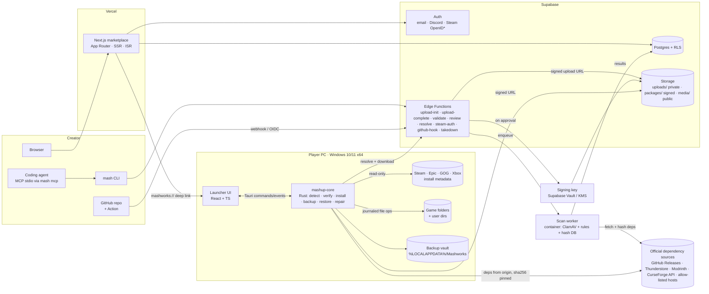
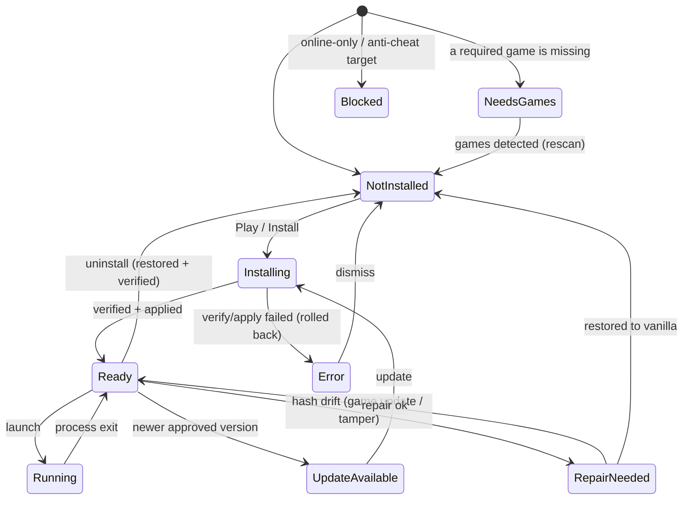

# Mashup platform: Phase 0 plan

Status: **draft for approval**. Nothing in Phases 1–6 starts until the Phase 0 gate is approved.

Working brand values (all in `platform/brand.json`, so a rename is a one-file change; see DECISIONS.md D-001):

| Placeholder | Working value |
|---|---|
| `{{PLATFORM_NAME}}` | **Mashworks** |
| `{{PRIMARY_COLOR}}` | `#FF5A1F` (ember) |
| `{{SECONDARY_COLOR}}` | `#14E3C0` (circuit teal) on `#12100E` ink |
| `{{VOICE}}` | Playful and precise: a workshop, not a casino. Short sentences, credit people by name, never hype. |
| `{{cli}}` | `mash` |
| `{{scheme}}` | `mashworks` → `mashworks://mashup/<id>` |

## 1. How this fits the existing repo

This repo is already the *creator* side: the `um` CLI (game detection, backups, publish lint), the agent
skills (`mod-any-game`, `mashup-mods`, `publish-mod`...) and a knowledge base of how real games were modded.
The README promises "Coming next: the mod hub". The platform is that hub, and it is built on what exists:

| Existing piece | Becomes |
|---|---|
| `um/scan.py` (Steam VDF, Epic manifests, Xbox folders, anti-cheat and loader signatures, engine fingerprints) | Ported to Rust as `mashup-core::detect`. The signature tables move to a shared `platform/data/signatures.json` read by both. |
| `um/backup.py` (zip + sha1 manifest) | Re-specified as the install engine's transactional backup with sha256 and restore verification. |
| `um/publish.py` (game-file hash match, secrets, decompiler fingerprints, engine archives) | The rules become the server-side scanner's rule set (`platform/packages/scan-rules`), shared with `mash validate`. |
| `skills/*` + `knowledge/` | The hosted "Mashup Creator Agent" instructions (`docs/agent-instructions.md`) point agents here to build mods, then at `mash` to package and publish them. |
| `skills/mod-any-game/references/safety.md` | The platform's content policy and online-protection rules. |

Nothing existing is removed. The Python toolkit keeps working, and its CI checks (`pytest`, `um kb check`,
`um publish check .`) stay green throughout.

## 2. Architecture



\* Supabase Auth has no Steam provider. Steam sign-in is an Edge Function doing OpenID 2.0 verification
against `steamcommunity.com/openid`, then linking the SteamID to a Supabase user (DECISIONS.md D-006).

### Repo layout (new code only)

```
platform/
  brand.json                 name, colors, voice, cli name, URL scheme
  data/signatures.json       anti-cheat, loader, engine signatures (shared with um/scan.py)
  packages/manifest/         mashup.schema.json (JSON Schema 2020-12) + TS types + examples
  packages/scan-rules/       file-type policy, secret/decompile patterns, archive policy (TS, shared by EF + CLI)
  crates/mashup-core/        Rust library: detection, manifest, verify, install engine, backup/restore/repair
  launcher/                  Tauri 2 app (src-tauri/ uses mashup-core; ui/ React + Vite + TS)
  web/                       Next.js App Router marketplace
  cli/                       `mash` (Node 22 + TS): login, init, validate, publish --draft, mcp
  supabase/                  config.toml, migrations/, functions/, seed.sql, tests/ (pgTAP-style SQL tests)
  scanner/                   Dockerfile + worker (ClamAV + scan-rules), pulls jobs from a Postgres queue
docs/agent-instructions.md   the hosted Mashup Creator Agent instructions
docs/platform/               this plan, package format, threat model, schema
```

## 3. Core flows

### Player: Play
1. Website "Play" opens `mashworks://mashup/<id>?v=<version>`. The launcher shows the mashup, never installs without a click.
2. Ownership gate: every `requires.games[]` entry must match a locally detected install (store id, plus optional version/exe fingerprint). Missing → store link, Play disabled.
3. Online gate: if the target game has anti-cheat or the manifest's mode is not `offline`/`self-hosted`/`lan`, Play is blocked or shows a blocking warning (see Threat model T-9).
4. Resolve: `resolve` Edge Function returns the approved version's signed package URL, sha256 and platform signature.
5. Verify: launcher checks the Ed25519 signature against the pinned public key, then every file hash in `checksums.json`.
6. Dependencies: fetched from their declared official source, verified against the pinned sha256. A dependency that cannot be fetched automatically (e.g. Nexus without premium) shows a "download it yourself" step and verifies the hash of what the player drops in.
7. Backup + apply: journaled file ops (below). 8. Launch via store URI or exe. 9. Uninstall/Repair.

### Install engine (transactional)
- **Plan**: expand ops into a concrete list of `(target, action, expected_pre_hash?)`. Reject any target outside the game root or the declared user dirs, any `..`, symlink/junction escape, or reparse point.
- **Journal**: write `journal.json` (intent) before touching anything; each op records `pre_sha256` (or `absent`) and `post_sha256`.
- **Backup**: copy each existing target into the vault keyed by sha256 (dedup) before modifying it.
- **Apply**: write to a temp file in the same folder, fsync, atomic rename. On any failure, roll back from the journal.
- **Uninstall**: restore every touched file from the vault, delete files we created *only if* their hash still equals our `post_sha256` (otherwise ask), then verify every restored file against `pre_sha256`. The report lists every file and its result.
- **Repair**: re-verify against the manifest. Restores from the vault where possible; where the vault cannot help (game updated underneath us), trigger the store's own verify (`steam://validate/<appid>`, Epic `com.epicgames.launcher://apps/<id>?action=verify`, GOG/Xbox: instructions) and clear the install record.
- **Crash recovery**: at startup, any journal not marked `committed` is rolled back.

### Play button state machine



### Creator: publish
`mash init` → `mash validate` (local: schema, file policy, secrets, hash check against a local game install
if given) → `mash publish --draft` → `upload-init` returns a signed upload URL for `uploads/<user>/<upload_id>.mashup`
→ `upload-complete` creates `mashup_versions(status='scanning')` and a scan job → scanner: size limits, zip-bomb
and path checks, schema, file-type policy, known-game-hash blacklist, ClamAV (+ optional VirusTotal hash
lookup), dependency source verification (download from the declared source, compare sha256, check the host is
allow-listed) → `in_review` (or `rejected` with reasons) → moderator approves → `sign` writes `signature` and
copies the package to `packages/` → `published`. GitHub publishing: a reusable Action runs `mash validate`
and `mash publish --draft` with a GitHub OIDC token exchanged for a short-lived upload token, so no secret is stored in the repo.

## 4. API list

Reads go through PostgREST with RLS (anon key on the web; the user's JWT when signed in). Writes that need
more than RLS (uploads, state transitions, signing) go through Edge Functions only.

| Endpoint | Caller | Auth | Purpose |
|---|---|---|---|
| `GET /rest/v1/mashups_public` (view) | web, launcher | anon | Discover: featured / trending / new / by game |
| `GET /rest/v1/mashups?slug=eq.` + embeds | web, launcher | anon | Detail: versions, games, deps, credits, media |
| `POST/PATCH /rest/v1/ratings`, `comments`, `reports` | web | user (RLS: own rows) | Social + reporting |
| `POST /functions/v1/validate` | CLI, agents, CI | none / token | Stateless manifest + file-list validation (no upload) |
| `POST /functions/v1/upload-init` | web, CLI | user or API token | Create upload session, return signed upload URL (size-capped) |
| `POST /functions/v1/upload-complete` | web, CLI | same | Seal upload, create draft version, enqueue scan |
| `GET /functions/v1/draft-status?version_id=` | CLI, agents | same | Scan results + review state |
| `POST /functions/v1/submit-review` | creator | owner | Move a clean draft to `in_review` |
| `POST /functions/v1/review-decision` | moderator | role=moderator | approve / reject / request changes (writes `review_actions`) |
| `POST /functions/v1/resolve` | launcher | anon (rate-limited) | Signed download URL + sha256 + signature for an approved version |
| `POST /functions/v1/install-event` | launcher | anon, opt-in | Anonymous install/uninstall counts for analytics |
| `POST /functions/v1/tokens` | web | user | Create / revoke API tokens (stored hashed) for CLI and agents |
| `GET /functions/v1/steam-auth/start`, `/callback` | web | none | Steam OpenID 2.0 sign-in / account link |
| `POST /functions/v1/github-hook` | GitHub | OIDC JWT, repo claim | Repo-based publishing |
| `POST /functions/v1/takedown` | anyone | none (captcha) | DMCA / takedown notice intake |
| `POST /functions/v1/invite` / `GET invite/<code>` | launcher, web | user | Phase 5 multiplayer invite links |
| internal: scan-worker → `scan_jobs` queue | scanner | service role | Claim job, write `scan_results`, set status |
| `mash mcp` (stdio MCP server) | coding agents | API token | Tools: `validate_manifest`, `create_draft`, `upload_package`, `draft_status`, `list_games` |

Launcher (Tauri commands, local only): `detect_games`, `rescan`, `get_play_state`, `install`, `uninstall`,
`repair`, `launch`, `get_logs`, `open_store_page`, `handle_deep_link`.

## 5. Phase plan and verification strategy

| Phase | Verified here (Linux container) | Needs Windows / external |
|---|---|---|
| 1 Launcher core | `cargo test` on mashup-core with fixture trees: fake Steam libraryfolders.vdf + appmanifests, Epic `.item` manifests, GOG and Xbox layouts behind a `Registry`/`Fs` trait; the "hello mod" install → uninstall → hash-verified restore on a test game folder | Real registry detection: GitHub Actions `windows-latest` job runs the same tests plus a registry-backed smoke test |
| 2 Web | `next build`, Playwright against `next start` with a local Postgres seeded with the real schema; RLS tests in SQL as `anon` / `authenticated` | Discord/Steam OAuth round-trips need real app credentials (your call) |
| 3 Pipeline | Edge Function logic as plain TS modules with unit tests; scanner container built and run against fixture packages (EICAR test string, fake game binary, path traversal, zip bomb) | Hosted Supabase project for staging (free tier is enough; asking first) |
| 4 Launcher UI | `vite build`, component tests, Playwright against the UI with a mocked Tauri bridge, screenshots reviewed | Windows build + installer: CI on `windows-latest` |
| 5 Multiplayer | Invite create/resolve/ownership-check tests | Real two-machine session |
| 6 Ship | Playwright suite, launcher integration tests, docs | Code-signing cert (paid), staging deploy (asking first) |

## 6. Questions for the gate

1. **Brand**: keep the working values above or give me real ones? (Fine to answer later; it is one file.)
2. **Where**: build under `platform/` in this repo (my recommendation: the skills, KB and lint rules are the creator half), or a new repo?
3. **Creator-made asset archives**: Unreal mods usually ship a creator-built `_P.pak`. The spec says reject asset archives. Options: (a) reject all archive formats (strict, blocks most UE mods), (b) allow creator archives only when no entry matches a known game hash *and* a moderator signs off (my recommendation), (c) allow freely.
4. **Malware scanning**: ClamAV in a small container (free software, but hosting it costs a few $/month) and optionally VirusTotal hash lookups (free tier forbids commercial use). Which, and may I create the hosting account when we get there?
5. **Phase 5 multiplayer**: enabled?
6. **Paid items** I will *not* touch without a yes: Windows code-signing (Azure Trusted Signing ≈ $10/month, or an OV certificate), Vercel Pro (Hobby forbids commercial use), Supabase Pro, any domain. Until then: unsigned dev builds, a self-signed test cert in CI, local Supabase.
