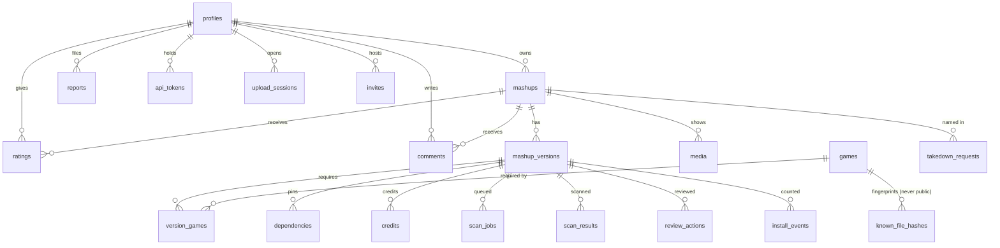

# Database schema overview

Source of truth: `platform/supabase/migrations/20261013000000_init.sql`.

Tests: `platform/supabase/tests/run.sh`, which applies a Supabase shim and the migrations to a throwaway
Postgres 16 database and runs 32 RLS checks as anon, a player, a creator and a moderator. CI runs it in the
`platform-db` job.

| Table | anon | authenticated | service role (Edge Functions) |
|---|---|---|---|
| profiles | read | read; update own name/bio/avatar/handle (not role, not linked ids) | all |
| games | read | read; moderators write | all |
| mashups | read listed/unlisted | + own drafts; create own drafts; edit own text fields; moderators: removed/featured | counters, latest version |
| mashup_versions, version_games, dependencies, credits | published/yanked of public mashups | + own; moderators all | every status change |
| media | of visible mashups | owner writes | all |
| ratings | read | own; not on own mashup | aggregates |
| comments | non-hidden | own; only moderators hide | all |
| reports | none | create own; read own; moderators triage | all |
| scan_results, review_actions | none | owner + moderators read | write |
| upload_sessions | none | read own | write |
| api_tokens | none | read own (never the hash); revoke own | create |
| known_file_hashes, scan_jobs, install_events | none | none (stats via `creator_stats()`) | all |
| takedown_requests | none (intake via function) | moderators read | all |
| invites | none | own | redeem |

Storage buckets (Phase 3):
- `uploads` (private, size-capped signed upload URLs, owner-only);
- `packages` (private, signed download URLs from `resolve`);
- `media` (public read, owner write under `<mashup_id>/`).
